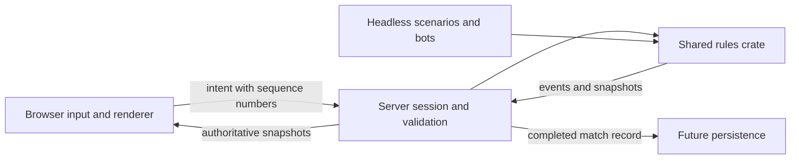

# Architecture

**Human UI review update (2026-11-08):** the user verified and approved all implemented UI/rendered changes, including earlier pending revisions through ADR 0022. This supersedes the historical pending-review statements below. See [review scope and evidence](UI-REVIEW.md); automated checks, hosted CI, performance and asset licensing remain separate.

## Implemented today

`arena-headless` supplies a scripted list of commands to `arena-sim`. The simulation contains a deliberately tiny one-dimensional duel: bounded movement, range, damage, cooldown, and match completion. The script prints tick-tagged events. Rules run at a proposed 30 Hz and use integer state. Commands resolve in supplied order; ties are not simultaneous. The test replays the same input twice and compares events and state.

The browser spike adds `arena_sim::arena`: planar movement with integer coordinates, normalized movement limits, wall/pillar collision, range and line-of-sight checks, cooldowns and round completion. `arena-client` presents these rules in a Bevy 3D scene with character-relative movement and a React HTML/CSS HUD. Browser input is sampled before fixed updates; positions interpolate for rendering. See [ADR 0002](decisions/0002-browser-spike.md) and [ADR 0007](decisions/0007-react-combat-ui.md).

`web/input.js` retains deterministic mouse intent and the positional input contract. `web/src/runtime` owns event arbitration, pointer lifecycle, startup and diagnostics. Its physical-key resolver supplies movement and dispatches one-shot domain actions; the old fixed keyboard methods remain only as a tested compatibility API. `bridge` validates read-only engine snapshots and loads WASM; Rust publishes rule-owned health limits and Pulse metadata. Static local entity IDs identify the two practice actors independently of target/focus selection. They are not multiplayer IDs.

Reset intent synchronously notifies input adapters before queuing the one-shot engine reset, so resolver holds, mouse gestures and browser pointer capture cancel together from either keyboard or menu commands. The input router also cancels on observed round completion, engine disappearance or tick rollback; round-completion snapshots bypass HUD throttling. This does not automatically restart a round or change combat rules. Human browser review of this lifecycle correction is pending.

`domain` is framework-independent configuration and deterministic transitions. `state` owns separate immutable engine, interaction and preference stores with narrow React subscriptions. `features` compose shared `ui` primitives; feature editors are public composition entry points, not shared component internals. `ui/Placed` provides viewport layout; `runtime/spell-drag` is the same-page drag adapter. Nothing below the React features imports feature internals. `app` composes loading, practice, frames, bars, spellbook, settings and opt-in diagnostics; no legacy HUD runs in parallel. The canvas is outside React's root.

[ADR 0008](decisions/0008-gameplay-first-ui.md) revises the overlay to gameplay-first focus (`runtime/focus`), a bindable Escape menu, direct whole-frame selection/dragging with a movable editor, hidden absent target/focus, drag-only icon spellbook and canvas discard. `ui/useMovable` shares bounded positioning between HUD elements and the editor window. Radix Themes 3.3.0 supplies styling tokens/components; its themed overlay contains dialog/tooltip portals without owning the canvas. Typing/modal/editing owners suspend gameplay; ordinary HUD focus and the nonmodal spellbook do not.

[ADR 0009](decisions/0009-pointer-spell-placement.md) replaces native HTML spell dragging with a captured-pointer controller, shared 64px icon/track sizing, ghost/target feedback and a visible unlock action for saved locked profiles. Armed presses defer focus recovery; only threshold-crossing gestures become assignment drags. No simulation or positional engine ABI changed.

Node tests exercise legacy input directly; Vitest exercises domain modules and production DOM/runtime adapters without a browser or WASM. Rust tests exercise rules and presentation contracts. See [ADR 0004](decisions/0004-unit-first-validation.md) and [frontend boundaries](FRONTEND.md). Rendered integration remains manual.

[ADR 0010](decisions/0010-unit-tag-frame-interactions.md) unifies live frame clicks through unit tags: left-click targets, right-click focuses, including the player. The local bridge appends self-selection at input index 13 and publishes `selectedPlayer`; existing indices remain unchanged. Missing future opponent/team slots resolve to nothing. Self-targeted attacks remain invalid under simulation rules.

[ADR 0023](decisions/0023-world-model-focus.md) extends right-click focus to world models. One-shot coordinates append at input indices 15–16; Rust uses rendered-unit/pillar picking shared with left-click targeting and returns a local tag through optional `onFocusUnit`. Browser focus remains independent of selection; misses preserve focus and drags/chords do not focus. Nameplates remain usable through pillars. Human rendered review of model focus is pending separately from earlier approvals.

The optional BaseMale glTF character is a presentation child of the existing player entity, normalized to the arena scale. A generated asset manifest lets builds without the local source use the procedural fallback without fetching a missing model. Loading state is exposed through the existing debug snapshot; collision and game rules do not depend on model geometry. See [asset provenance](../assets/README.md).

[ADR 0015](decisions/0015-procedural-humanoids.md) replaces capsule placeholders with procedural humanoids. Internal appearance data separates skin/hair/eye colors, clothing, proportions and hairstyle from simulation identity; customization UI/persistence and skeletal animation remain deferred. The player humanoid is also the optional model's loading/error fallback. Human rendered review is pending.

[ADR 0016](decisions/0016-procedural-locomotion.md) adds presentation-only procedural locomotion through shoulder/elbow/hip/knee transform pivots. Interpolated displacement drives local-direction gait and rule-owned height drives the airborne pose. A shared carrier keeps body bob and cosmetic weapons together without moving ground markers or gameplay bounds. Internal settings keep animation tuning separate from appearance and rules. The optional unrigged model receives only carrier motion, not limb animation. Human rendered review is pending.

[ADR 0021](decisions/0021-base-male-skeletal-character.md) supersedes the unrigged optional player with the local Blender-authored BaseMale skeleton and eight clips. A build adapter isolates its scene, strips authoring metadata and removes authored Jump root translation. A Bevy 0.20.1 animation graph selects locomotion from actual local displacement, seeks jump limb poses against rule-owned flight and plays a cosmetic Cast release on successful Pulse cooldown edges. No cast-time/damage or movement rules change; Attack is retained but has no new ability/binding. Authored models do not receive duplicate procedural bob. The opponent and absent/loading/error fallback stay procedural. Human browser review is pending.

[ADR 0025](decisions/0025-team-practice-rosters.md) adds local 1v1/2v2/3v3 practice rosters, left-side team frames excluding self, team-safe damage and whole-team elimination. Actor indices alternate sides; optional roster/selection snapshot fields and appended input fields preserve the legacy two-actor fallback. Nameplates, picking, target/focus and outgoing text resolve every active actor. Human rendered review is pending. This supersedes the earlier two-actor/no-teammate descriptions above and below.

Durable replay files, interrupts, networking and server validation are not implemented. The public simulation API is provisional.

[ADR 0022](decisions/0022-world-health-nameplates.md) adds health-only world nameplates for non-player units. Optional normalized projections publish after camera/transform updates and feed a separate render-rate frontend store, independent of ordinary HUD throttling. Bars reuse unit-tag target/focus commands; profile settings and remappable friendly/enemy toggles control visibility. Nameplates remain visible/clickable through pillars; world-hover occlusion and combat line of sight remain unchanged. The current scene has no teammates. The through-pillar correction follows the earlier UI approval and awaits human rendered review.

The original Verdant Eclipse GLB now supplies the player's two crossed cosmetic back weapons. A build-time adapter extracts a weapon-only scene without modifying the user's Blender export; per-instance readiness hides only the corresponding procedural fallback. Shared motion carriers and mount transforms are preserved. No simulation rules or input ABI change. See [ADR 0017](decisions/0017-imported-glaives.md).

[ADR 0018](decisions/0018-weapon-appearance-selector.md) adds a device-local Settings → Weapons selector for paired glaives or the imported Aetherthorn staff, each with six energy palettes. A separate optional presentation callback replaces random startup selection. Requested combinations are lazily cached behind mutually exclusive parent visibility; per-instance loading fallbacks remain intact. Both are cosmetic back weapons, independent of simulation and character loading. Human rendered review is pending.

[ADR 0019](decisions/0019-weapon-lighting-and-visibility.md) fixes missing visibility on weapon mounts (previously allowing both cached weapons to appear), adds descendant-level visibility regressions, and introduces optional thresholded HDR bloom. After user review found the initial HDR version too dark and without a body halo, the revision restores brighter lighting, sets explicit exposure/Reinhard mapping, raises crystal emission above the bloom threshold and adds camera-facing soft halos/animated sparks directly to the staff. Settings → Graphics saves the bloom toggle through an appended presentation callback field; local effects remain active independently. Human rendered review of this correction is pending.

[ADR 0020](decisions/0020-temporary-live-lighting-panel.md) adds a temporary movable nonmodal lighting panel with ten session-only sliders. A separate optional presentation callback updates background, tagged arena lights, camera exposure and existing bloom in place, after ordinary graphics preferences; combat input/rules and assets are unchanged. The user's manually tuned EV100 10.0 is preserved as the starting exposure. Human browser review remains pending.

The 2026-11-08 extension appends color grading, tagged light colors/directions and tone mapping to that callback (29 numeric fields total), preserving older ten-field shells and neutral starting grading. Visual grouping is independent of callback order. Updates remain presentation-only; camera/actor transforms, materials, HUD colors and simulation are unchanged. Human rendered review remains pending.

[ADR 0011](decisions/0011-unit-tooltips.md) adds a shared anchored unit tooltip for frame and world hover. A separate optional `readHover` shell callback supplies canvas coordinates; Rust presentation picking publishes a read-only `hoveredUnit` tag without changing the command ABI or simulation. The tooltip reuses `TooltipCard` and `Placed`, with a persisted bottom-right default and editable layout preview.

## Intended boundaries

[ADR 0027](decisions/0027-browser-focus-frame-pacing.md) makes WASM Winit updates continuous independently of canvas focus, preserving native low-power defaults and existing input/visibility cancellation. A separate engine-publication interval series distinguishes actual app update cadence from the browser rAF counter; neither is GPU-presented FPS. This follows a measured 239.8 browser callbacks/s versus 72.6 engine updates/s that returned to 240.2 engine updates/s after a canvas focus cycle. The exact upstream focus-event sequence remains unisolated; subjective human review of the correction is pending.

[ADR 0026](decisions/0026-frame-timing-overlay.md) isolates compact debug performance diagnostics from engine snapshot delivery. A bounded browser-interval ring feeds a four-Hz store only while the overlay is visible; the large JSON snapshot mounts/subscribes only on explicit expansion. Hidden/not-ready gaps are excluded and runtime cleanup stops the sampling loop. These are browser frame intervals, not GPU timings or a measured performance claim.

[ADR 0024](decisions/0024-outgoing-combat-text.md) adds presentation-only outgoing combat numbers from attributed successful events, never inferred health differences. A bounded queue excludes other sources and the local recipient, then publishes render-rate overhead projections through the existing scene store. Signed amounts support healing presentation; only damage is implemented in the simulation. Nameplate toggles/settings also announce enabled/disabled in yellow alongside independent red cast errors. Human rendered review is pending.

[ADR 0014](decisions/0014-camera-collision.md) adds presentation-only orbit-camera collision against bounds attached to static map boxes. Eye contact retracts the camera, while a padded eye-motion sweep slides along surfaces and prevents tunneling; distant pillars may obscure the player without forcing zoom-in. Floor constraints prevent below-map views, and eased recovery restores the separate requested zoom. No simulation or input ABI changes are involved. Human browser review of the contact-only revision is pending.

[ADR 0013](decisions/0013-momentum-jumping.md) adds simulation-owned momentum jumping: integer height/gravity, carried takeoff displacement, no air steering or double-jump, and the existing planar collision/combat footprint. The client interpolates height; remappable Space appends a one-shot intent at input index 14. Human browser review is pending.

[ADR 0012](decisions/0012-graphics-quality.md) adds device-local Off/4× MSAA and Low/High procedural detail through a separate optional graphics callback. Preferences apply only to presentation and persist independently of HUD profiles; simulation and combat input ordering are unchanged.

Headless and local browser adapters use the shared rules today; the server boundaries remain planned. The server will derive actor identity from an authenticated session. Never accept arbitrary actor IDs, damage, health or client-authored coordinates as authority. Add per-tick command budgets and length/rate limits at ingress. Decide fair command ordering explicitly before competitive play; a stable actor order alone could create bias.

Keep simulation time separate from rendering and transport. Browser prediction may reuse rules but does not decide outcomes. Snapshot interpolation and future reconciliation must expose correction metrics. Version replay content, rules and protocol so results remain explainable after balance changes.

A future development bridge should expose structured state and command injection for browser automation and screenshots. Keep debug capabilities out of public competitive sessions. Do not require editor interaction or an external AI service to run tests.

Model-focus review update (2026-11-08): the user approved the completed ADR 0023 change. Its pending human-review statement above is superseded; see [review record](UI-REVIEW.md#subsequent-changes).
