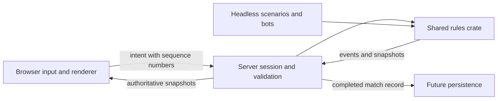

# Architecture

## Implemented today

`arena-headless` supplies a scripted list of commands to `arena-sim`. The simulation contains a deliberately tiny one-dimensional duel: bounded movement, range, damage, cooldown, and match completion. The script prints tick-tagged events. Rules run at a proposed 30 Hz and use integer state. Commands resolve in supplied order; ties are not simultaneous. The test replays the same input twice and compares events and state.

The browser spike adds `arena_sim::arena`: planar movement with integer coordinates, normalized movement limits, wall/pillar collision, range and line-of-sight checks, cooldowns and round completion. `arena-client` presents these rules in a Bevy 3D scene with character-relative movement and a React HTML/CSS HUD. Browser input is sampled before fixed updates; positions interpolate for rendering. See [ADR 0002](decisions/0002-browser-spike.md) and [ADR 0007](decisions/0007-react-combat-ui.md).

`web/input.js` retains deterministic mouse intent and the positional input contract. `web/src/runtime` owns event arbitration, pointer lifecycle, startup and diagnostics. Its physical-key resolver supplies movement and dispatches one-shot domain actions; the old fixed keyboard methods remain only as a tested compatibility API. `bridge` validates read-only engine snapshots and loads WASM; Rust publishes rule-owned health limits and Pulse metadata. Static local entity IDs identify the two practice actors independently of target/focus selection. They are not multiplayer IDs.

`domain` is framework-independent configuration and deterministic transitions. `state` owns separate immutable engine, interaction and preference stores with narrow React subscriptions. `features` compose shared `ui` primitives; feature editors are public composition entry points, not shared component internals. `ui/Placed` provides viewport layout; `runtime/spell-drag` is the same-page drag adapter. Nothing below the React features imports feature internals. `app` composes loading, practice, frames, bars, spellbook, settings and opt-in diagnostics; no legacy HUD runs in parallel. The canvas is outside React's root.

[ADR 0008](decisions/0008-gameplay-first-ui.md) revises the overlay to gameplay-first focus (`runtime/focus`), a bindable Escape menu, direct whole-frame selection/dragging with a movable editor, hidden absent target/focus, drag-only icon spellbook and canvas discard. `ui/useMovable` shares bounded positioning between HUD elements and the editor window. Radix Themes 3.3.0 supplies styling tokens/components; its themed overlay contains dialog/tooltip portals without owning the canvas. Typing/modal/editing owners suspend gameplay; ordinary HUD focus and the nonmodal spellbook do not.

[ADR 0009](decisions/0009-pointer-spell-placement.md) replaces native HTML spell dragging with a captured-pointer controller, shared 64px icon/track sizing, ghost/target feedback and a visible unlock action for saved locked profiles. Armed presses defer focus recovery; only threshold-crossing gestures become assignment drags. No simulation or positional engine ABI changed.

Node tests exercise legacy input directly; Vitest exercises domain modules and production DOM/runtime adapters without a browser or WASM. Rust tests exercise rules and presentation contracts. See [ADR 0004](decisions/0004-unit-first-validation.md) and [frontend boundaries](FRONTEND.md). Rendered integration remains manual.

[ADR 0010](decisions/0010-unit-tag-frame-interactions.md) unifies live frame clicks through unit tags: left-click targets, right-click focuses, including the player. The local bridge appends self-selection at input index 13 and publishes `selectedPlayer`; existing indices remain unchanged. Missing future opponent/team slots resolve to nothing. Self-targeted attacks remain invalid under simulation rules.

The optional glTF character is a presentation child of the existing player entity, normalized to the arena scale. A generated asset manifest lets clean clones use the procedural fallback without fetching a missing/private download. Loading state is exposed through the existing debug snapshot; collision and game rules do not depend on model geometry. See [asset provenance](../assets/characters/README.md).

Durable replay files, interrupts, teams, networking and server validation are not implemented. The public simulation API is provisional.

[ADR 0011](decisions/0011-unit-tooltips.md) adds a shared anchored unit tooltip for frame and world hover. A separate optional `readHover` shell callback supplies canvas coordinates; Rust presentation picking publishes a read-only `hoveredUnit` tag without changing the command ABI or simulation. The tooltip reuses `TooltipCard` and `Placed`, with a persisted bottom-right default and editable layout preview.

## Intended boundaries

[ADR 0014](decisions/0014-camera-collision.md) adds presentation-only orbit-camera collision against bounds attached to static map boxes. Eye contact retracts the camera, while a padded eye-motion sweep slides along surfaces and prevents tunneling; distant pillars may obscure the player without forcing zoom-in. Floor constraints prevent below-map views, and eased recovery restores the separate requested zoom. No simulation or input ABI changes are involved. Human browser review of the contact-only revision is pending.

[ADR 0013](decisions/0013-momentum-jumping.md) adds simulation-owned momentum jumping: integer height/gravity, carried takeoff displacement, no air steering or double-jump, and the existing planar collision/combat footprint. The client interpolates height; remappable Space appends a one-shot intent at input index 14. Human browser review is pending.

[ADR 0012](decisions/0012-graphics-quality.md) adds device-local Off/4× MSAA and Low/High procedural detail through a separate optional graphics callback. Preferences apply only to presentation and persist independently of HUD profiles; simulation and combat input ordering are unchanged.

Headless and local browser adapters use the shared rules today; the server boundaries remain planned. The server will derive actor identity from an authenticated session. Never accept arbitrary actor IDs, damage, health or client-authored coordinates as authority. Add per-tick command budgets and length/rate limits at ingress. Decide fair command ordering explicitly before competitive play; a stable actor order alone could create bias.

Keep simulation time separate from rendering and transport. Browser prediction may reuse rules but does not decide outcomes. Snapshot interpolation and future reconciliation must expose correction metrics. Version replay content, rules and protocol so results remain explainable after balance changes.

A future development bridge should expose structured state and command injection for browser automation and screenshots. Keep debug capabilities out of public competitive sessions. Do not require editor interaction or an external AI service to run tests.
