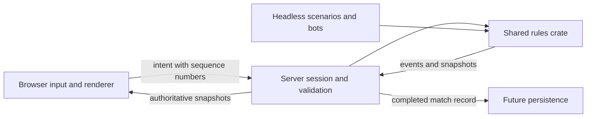

# Architecture

## Implemented today

`arena-headless` supplies a scripted list of commands to `arena-sim`. The simulation contains a deliberately tiny one-dimensional duel: bounded movement, range, damage, cooldown, and match completion. The script prints tick-tagged events. Rules run at a proposed 30 Hz and use integer state. Commands resolve in supplied order; ties are not simultaneous. The test replays the same input twice and compares events and state.

The browser spike adds `arena_sim::arena`: planar movement with integer coordinates, normalized movement limits, wall/pillar collision, range and line-of-sight checks, cooldowns and round completion. `arena-client` presents these rules in a Bevy 3D scene with camera-relative movement and a plain HTML HUD. Browser input is sampled before fixed updates; positions interpolate for rendering. See [ADR 0002](decisions/0002-browser-spike.md).

Durable replay files, interrupts, teams, networking and server validation are not implemented. The public simulation API is provisional.

## Intended boundaries

Headless and local browser adapters use the shared rules today; the server boundaries remain planned. The server will derive actor identity from an authenticated session. Never accept arbitrary actor IDs, damage, health or client-authored coordinates as authority. Add per-tick command budgets and length/rate limits at ingress. Decide fair command ordering explicitly before competitive play; a stable actor order alone could create bias.

Keep simulation time separate from rendering and transport. Browser prediction may reuse rules but does not decide outcomes. Snapshot interpolation and future reconciliation must expose correction metrics. Version replay content, rules and protocol so results remain explainable after balance changes.

A future development bridge should expose structured state and command injection for browser automation and screenshots. Keep debug capabilities out of public competitive sessions. Do not require editor interaction or an external AI service to run tests.
